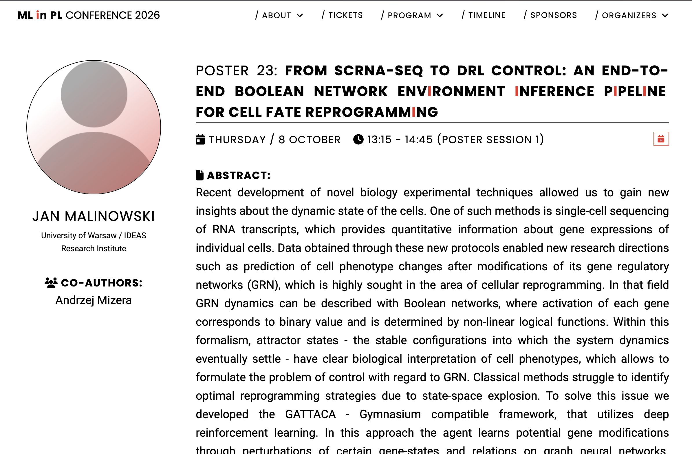

# scBoolNet: An End-to-End scRNA-seq to Boolean Network Inference Pipeline Leveraging FlowGRN Trajectory Reconstruction

## Abstract
In this paper we present the idea of an end-to-end data transformation pipeline that leads from scRNA-seq data into sets of Boolean network functions ready to be used by GATTACA’s learning agent. We show different stages and branching points along with the mathematical descriptions and motivations behind our decisions. We pinpoint major issues related to scRNA-seq data such as the curse of dimensionality or intraspecies variation and explain how we handle them. Firstly, we preprocess data with statistical methods to filter out experimental artifacts. We perform feature selection based on gene expressions variability accounting for batch effects from different data sources. We integrate data utilizing constituted benchmarks and annotate cell types with transfer learning through embeddings similarity. At the end data from lineage tracing and in splicing is incorporated into pseudo time trajectory inference. Finally, candidate interactions are retrieved from the CollecTRI database, and dynamically refined via trajectory reconstruction utilizing generative ODE modeling to construct a cell-type-specific signed GRN, which is subsequently fed into BoNesis for Boolean model synthesis.
We propose a strictly ordered pipeline integrating statistical, probabilistic, and machine learning techniques to generate state-of-the-art Boolean networks models. We identify and address conceptual challenges encountered during pipeline development and outline future research directions.

**Keywords**: computational biology, scRNA-seq, Boolean networks, graph neural networks, deep reinforcement learning

## Current Status: Work in Progress
This work is stil under development and is expected to be finished around the end of 2026.  
We started working on this pipeline on **March 2026** and on October we reached testing stage that continues to this day as we currently carry out main experiments.
Our ideas were already presented during two conferences:
- ML in PL 2026 at **8th of October** (poster),
- Young Science Beyond Borders 2026 at **19th of October** (oral presentation).

Poster that was created for the former conference was placed below along with timestamped proof of its presentation during aforementioned day.

## License
Copyright (c) 2026 **IDEAS Research Institute**. All rights reserved.

This repository is published solely to document the progress and timeline of this work. No license is granted to use, copy, modify, merge, publish, distribute, sublicense or sell the code, notebooks or any other materials contained in it, in whole or in part, without prior written permission from the rights holders.